

 

<h2 align="center">🛠️ Tech Stack</h2>

  

 

<h2 align="center">🚀 My Projects</h2>

Things I've built on my own

  <a href="https://github.com/Thanu-san/Project-Employee-Management-System"></a>
  <a href="https://github.com/Thanu-san/Fronted-Mini-project-G4"></a>
  <a href="https://github.com/Thanu-san/Java-mini-project-movie-search"></a>
  <a href="https://github.com/Thanu-san/My-React-Foundation-Project"></a>
  <a href="https://github.com/Thanu-san/Fronted-FinalProject-G2"></a>
  <a href="https://github.com/Thanu-san/ISTAD-Bachelor-S2-nextjs"></a>
  <a href="https://github.com/Thanu-san/InventoryManagementSystem"></a>

 

<h2 align="center">🤝 Collaborations</h2>

Things I've built together with my team

  <a href="https://github.com/nxthh/Angkorism"></a>
  <a href="https://github.com/TongAnWasHere/wordlepp_istad"></a>
  <a href="https://github.com/seavminhleang-art/Mini-project-group-4"></a>
  <a href="https://github.com/Hokchheng07/Guardians_of_Angkor"></a>
  <a href="https://github.com/Oudom-Ratana/Final_Project_Foundation_Gen6"></a>
  <a href="https://github.com/Reaksmey8/LifeForgeFinalProjectjava"></a>

 

<h2 align="center">🐍 Contribution Snake</h2>

  <picture>
    <source media="(prefers-color-scheme: dark)" srcset="https://raw.githubusercontent.com/Thanu-san/Thanu-san/output/github-snake-dark.svg" />
    <source media="(prefers-color-scheme: light)" srcset="https://raw.githubusercontent.com/Thanu-san/Thanu-san/output/github-snake.svg" />
    
  </picture>

 

